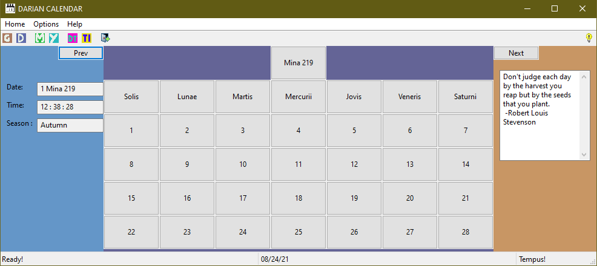
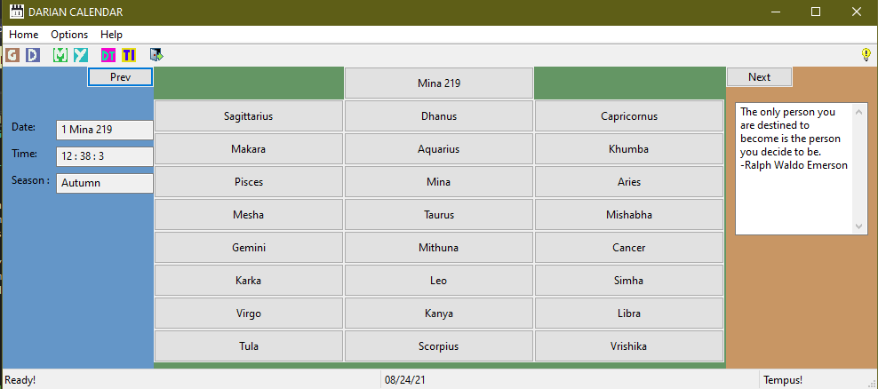
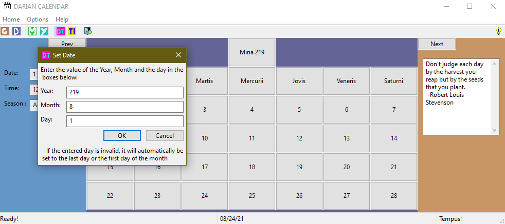
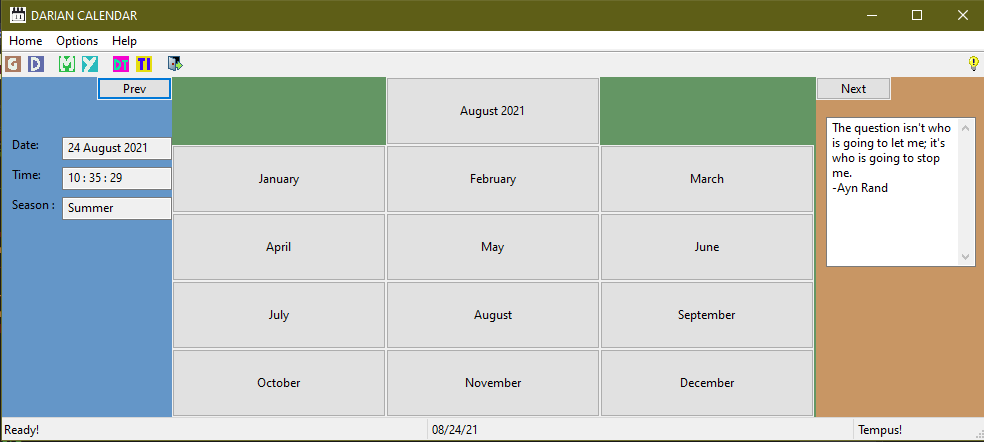
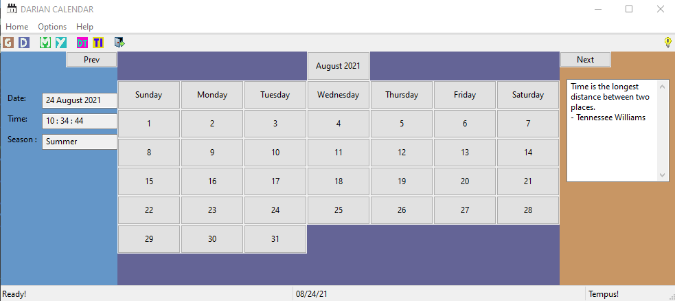
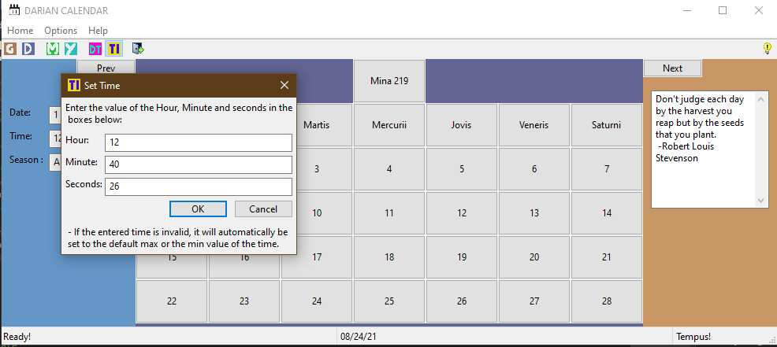

# Tempus — WxWidgets Darian Calendar

**Release Version 1.0**

A desktop calendar application written in **C++ / wxWidgets** that displays the familiar **Gregorian (Earth) calendar** and the **Darian (Mars) calendar** side by side, with live time, date navigation, date/time setting dialogs, seasons and a quote of the month.

Made by **Tempus**.

---

## Table of Contents

- [Screenshots](#screenshots)
- [About the Darian Calendar](#about-the-darian-calendar)
- [Features](#features)
- [How to Use](#how-to-use)
- [Building the Project](#building-the-project)
- [Project Structure](#project-structure)
- [Authors](#authors)
- [Links](#links)

---

## Screenshots

| Gregorian month view | Darian month view |
| --- | --- |
|  |  |

| Gregorian year view | Darian year view |
| --- | --- |
|  |  |

| Set Date dialog | Set Time dialog |
| --- | --- |
|  |  |

---

## About the Darian Calendar

The **Darian calendar** is a calendar system proposed for use on **Mars** (named after Thomas Gangale's Darian calendar). Because a Mars day (*sol*) is longer than an Earth day and a Mars year is much longer than an Earth year, the calendar is built around different units:

| Quantity | Value used in this project |
| --- | --- |
| Length of a sol | `24.65979` Earth hours (≈ 24 h 39 m 35.244 s) |
| Sols in a year | `668.6` sols (the "10 years = 6686 sols" rule) |
| Epoch offset | `138920.13356` sols between the start of the Darian calendar (1609) and 2000-01-01 |
| Months | 24 months per year, named in pairs of Western zodiac / Sanskrit names (Sagittarius–Dhanus, Capricornus–Makara, … Scorpius–Vrishika) |
| Month length | 28 sols, with every 6th month having 27 sols (4 × (5×28 + 27) = **668 sols**) |
| Weekdays | 7-day weeks: **Solis, Lunae, Martis, Mercurii, Jovis, Veneris, Saturni** |
| Seasons | Winter, Autumn, Summer, Spring |

Both calendars are implemented as separate classes with their own conversion, navigation and display logic, and both are shown in the same window so you can compare Earth time with Mars time at a glance.

---

## Features

**Two calendars in one window**

1. Switch between **Gregorian (Earth)** and **Darian (Mars)** calendars from the menu bar or the toolbar.
2. Switch between **Month view** and **Year view** for whichever calendar is active.
3. **Prev / Next** buttons to navigate to the previous / next month or year in both views.

**Date & time**

4. Custom **Set Date** dialog (Year / Month / Day) — an invalid day is automatically clamped to the first or last day of the month.
5. Custom **Set Time** dialog (Hour / Minute / Second) — invalid values are clamped to the allowed minimum / maximum.
6. The clock ticks **every second** via a `wxTimer`, updating the time field of the active calendar (the date/season fields refresh on navigation or when you set the date).

**Presentation**

7. The current **date**, **time** and **season** are shown in the left panel and change with the active calendar.
8. A **quote of the month** is displayed in the right panel (Gregorian months and Darian months each have their own set of quotes).
9. **Menu bar** (*Home*, *Options*, *Help*) and a **toolbar** with icons for all main actions.
10. **Status bar** with three fields: current state message, the current Gregorian date, and a "Tempus!" label.

**Code organisation**

11. Separate classes for the Gregorian calendar (`Gregorian_DateTime`) and the Darian calendar (`Darian_Date_Time`), plus dedicated classes for the main window and both dialogs.

---

## How to Use

### Launch

Start the application — the main window titled **DARIAN CALENDAR** opens in the **Gregorian month view** with the current date and time.

> **Note:** the two calendars keep their **own** date/time state — switching between them does not convert one into the other, it simply shows that calendar's current values.

### Menu bar

| Menu | Item | Action |
| --- | --- | --- |
| **Home** | *Georgian* | Switch to the Gregorian calendar |
| | *Darian* | Switch to the Darian (Mars) calendar |
| | *Quit* | Close the application |
| **Options** | *Set Date* | Open the Set Date dialog for the **currently active** calendar |
| | *Set Time* | Open the Set Time dialog for the **currently active** calendar |
| | *Switch Views* → *To Year* | Show all 12 (Gregorian) or 24 (Darian) months of the current year |
| | *Switch Views* → *To Months* | Show the month grid of the active calendar |
| **Help** | *About* | Show the about box with the project description and authors |

> The view switch items live in the **Switch Views** sub-menu of *Options*; the same actions are available as toolbar buttons.

### Toolbar

From left to right: **Georgian calendar**, **Darian calendar**, **Months view**, **Year view**, **Set Date**, **Set Time**, **Quit**, and **About** (far right).

### Navigating

- **Prev** (top-left of the calendar) — go to the previous month (in month view) or previous year (in year view).
- **Next** (top-right of the calendar) — go to the next month / year.
- In **year view** you see every month of the current year laid out as buttons (12 for Gregorian, 24 for Darian), with the current month/year in the header.

### Setting the date

1. Make sure the calendar you want to edit is active (**Georgian** or **Darian** button in the toolbar).
2. **Options → Set Date** (or the *setDate* toolbar button).
3. Enter **Year**, **Month** and **Day** — e.g. `219 / 8 / 1` for *1 Mina 219* in the Darian calendar.
   *OK stays disabled until all three boxes are filled; an out-of-range day is set to the first/last day of the month.*
4. Press **OK** — the grid, the Date/Season fields and the status bar message ("Date set") update immediately.

### Setting the time

1. **Options → Set Time** (or the *setTime* toolbar button).
2. Enter **Hour**, **Minute** and **Seconds** (prefilled with the current values).
3. Press **OK** — the time field starts ticking from the new value ("Time set").

### Reading the window

- **Left panel** — `Date`, `Time` and `Season` of the active calendar (e.g. `1 Mina 219`, `12 : 38 : 28`, `Autumn`).
- **Center** — the calendar grid: month view (weekday header + day numbers) or year view (all month names).
- **Right panel** — a quotation for the current month.
- **Status bar** — `Ready!` | current Gregorian date | `Tempus!`.

---

## Building the Project

Made with **Microsoft Visual Studio Community 2019 (16.10.4)** and **wxWidgets 3.1.5**.

1. Install [Visual Studio](https://visualstudio.microsoft.com/downloads/) with the **Desktop development with C++** workload.
2. Download and build [wxWidgets 3.1.5](https://www.wxwidgets.org/downloads/) (see the [official MSW install guide](https://github.com/wxWidgets/wxWidgets/blob/v3.1.2/docs/msw/install.md)).
3. Open **`WxWidgets TEMP1.sln`** (or create an empty C++ project and configure the wxWidgets include/library paths in the project properties — saving this as a template is recommended for future wxWidgets projects).
4. Build **both Debug and Release** configurations, then copy the relevant wxWidgets `.dll` files into the project's `Debug` / `Release` output folders.
5. Run the project.

A detailed step-by-step guide (with the recommended setup video) is available in **[Build_Guide.txt](Build_Guide.txt)**.

Recommended setup video: https://www.youtube.com/watch?v=EI2taYkErRg&list=PLpHIphr3laQbBLJ8j4iXy8lieaiY9Q10y&index=1&t=4s

---

## Project Structure

```
WxWidgets-Darian_Calendar-Tempus-/
├── WxWidgets TEMP1.sln              Visual Studio solution
├── Build_Guide.txt                  Step-by-step build instructions
├── README.md                        This file
├── Capture*.PNG                     Screenshots used above
└── WxWidgets TEMP1/
    ├── App.cpp / App.h              wxApp entry point (creates the main window)
    ├── MainWindow.cpp / .h          Main frame: menus, toolbar, sizers,
    │                                timer, display_*() rendering functions
    ├── CalDateTime.cpp / .h         Darian_Date_Time class (Mars calendar)
    ├── Gregorian_DateTime.cpp / .h  Gregorian_DateTime class (Earth calendar)
    ├── setDateDialog.cpp / .h       "Set Date" dialog (with validation)
    ├── setTimeDialog.cpp / .h       "Set Time" dialog (with validation)
    ├── quotes.cpp / .h              Quote of the month for both calendars
    ├── id.h                         Window / control IDs
    ├── *.xpm                        Toolbar & dialog icons (Darian, Georgian,
    │                                Month, Year, Date, Time, Icon)
    ├── Icon.ico                     Application icon
    └── WxWidgets TEMP1.vcxproj      Visual Studio project file
```

---

## Authors

**Tempus**

- Bishal Khand Thakuri — `076bct018`
- Kaushal Gautam — `076bct030`
- Aadarsh Khatri — `076bct002`

---

## Links

- Repository: https://github.com/Bishalai/WxWidgets-Darian_Calendar-Tempus-
- wxWidgets: https://www.wxwidgets.org/downloads/ · https://github.com/wxWidgets/wxWidgets
- Visual Studio: https://visualstudio.microsoft.com/downloads/
